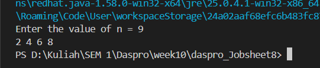
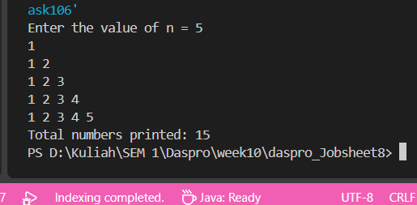
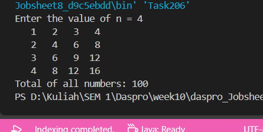
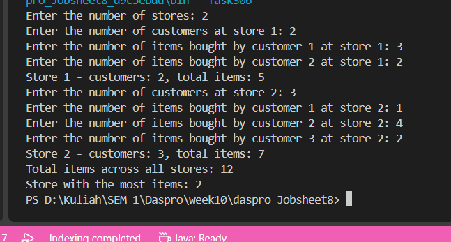

# JOBSHEET 8 - LOOPS 2

**Identitas Mahasiswa:**
* **Nama:** Datu Ayu Fitria Ceasa
* **NIM:** 264107020087
* **Kelas / No. Presensi:** 1I / 06

---

## 1: OBJECTIVES

1. Understand the concept of nested loops in algorithms 
2. Understand the flow of nested loops
3. Recognize the syntax of nested loops
4. Be able to apply nested loops to solve a simple case study. 

---

## 2: Practical Exercises

### 2.1 Experiment 1: Review of Loops 1

#### 2.1.1 Java Code
```java
import java.util.Scanner; 

public class Star06 { 
    public static void main(String[] args) { 
        Scanner sc = new Scanner(System.in); 
        System.out.print("Enter the value of n = "); 
        int n = sc.nextInt(); 
        
        for (int i = 1; i <= n; i++) { 
        System.out.print("*"); 
        } 
        System.out.println(); 
        sc.close(); 
    } 
}
```

#### 2.1.2 Screenshot Output


#### 2.1.3 Questions
* **Question 1:** If the initialization i = 1 is changed to i = 0 without changing the condition, how many characters are printed when n = 5? Explain.
  * **Answer:** If i starts at 0 and the condition stays i <= n, the loop prints a star for each value from 0 through 5 when n is 5. That is 6 values, so 6 stars are printed.
* **Question 2:** If the condition i <= n is changed to i < n, how many times does the loop run when n = 5? Why is the result different?  
  * **Answer:** With i starting at 0 and the condition i < n, the loop runs 5 times for n = 5, with i taking values 0 through 4. It differs because < stops before i reaches 5, while <= includes 5 and runs one extra time.
* **Question 3:** Predict the output of the following code fragment when n = 9, then verify it by replacing the FOR loop in your program and running it.
  ```
  for (int i = 2; i <= n; i += 2) { 
  System.out.print(i + " "); 
  } 
  ```
  * **Answer:**

* **Question 4:** Explain why changing the increment i++ to i-- (with the condition still i <= n) makes the loop run endlessly, so that it does not stop in a reasonable time for positive n. Do not run that version; if it has already started running, stop the program by pressing Ctrl + C in the terminal. 
  * **Answer:** If the loop starts with i = 1 and keeps the condition i <= n, then for positive n the condition is initially true. Changing i++ to i-- makes i smaller each iteration, so it never moves toward being greater than n; the loop keeps running and printing.
In Java, int eventually overflows, so it is not literally infinite: after billions of iterations, i wraps around and the condition may become false. But it won’t stop in a reasonable time. I did not run that version.
---

### 2.2  Experiment 2: Rectangle Star Pattern (Nested FOR)

#### 2.2.1 Java Code
```java
import java.util.Scanner; 

public class Rectangle06 { 
    public static void main(String[] args) { 
        Scanner sc = new Scanner(System.in); 
        System.out.print("Enter the number of rows: "); 
        int rows = sc.nextInt(); 
        System.out.print("Enter the number of columns: "); 
        int columns = sc.nextInt(); 

        for (int i = 1; i <= rows; i++) {    // outer loop: rows     
            for (int j = 1; j <= columns; j++) {   // inner loop: columns 
                System.out.print("*"); 
            } 
            System.out.println();    // new line              
        } 
    } 
}
```


#### 2.2.3 Questions
* **Question 1:** Explain the function of the variables i and j in the program.
  * **Answer:** In Rectangle06.java, i counts the rows in the outer loop, while j counts the columns in the inner loop. For each value of i (each row), j runs through all the columns, printing the row’s contents. Then j resets for the next row.
* **Question 2:** How many times are the outer loop, the inner loop, and the statement print("*") executed for rows = 4 and columns = 7? 
  * **Answer:** For rows = 4 and columns = 7:
    
                ~ The outer loop runs 4 times.
                ~ The inner loop runs 7 times per outer-loop iteration, or 28 times total.
                ~ print("*") executes 28 times.

    
* **Question 3:** What happens if the bounds of the outer and inner loops are swapped (the outer loop uses columns and the inner loop uses rows)? Use rows = 3 and columns = 6 to explain. 
  * **Answer:** With rows = 3 and columns = 6, swapping the bounds makes the outer loop run 6 times and the inner loop 3 times per outer iteration. The output becomes 6 rows of 3 asterisks. That’s still 18 asterisks total, but the rectangle’s dimensions are reversed.
* **Question 4:** Explain the effect of removing System.out.println(); after the inner loop.  
  * **Answer:** Without System.out.println(); after the inner loop, the program won’t move to a new line after printing each row. All asterisks will appear together on one line, forming a continuous sequence of rows × columns stars.
* **Question 5:** Modify the program so that the printed character is #, then commit and push the changes to GitHub.
  * **Answer:**
    

### 2.3 Experiment 3: Debugging a Star Triangle – Nested WHILE

#### 2.3.1 Java Code
```java
import java.util.Scanner; 
 
public class Triangle06 { 
    public static void main(String[] args) { 
        Scanner sc = new Scanner(System.in); 
        System.out.print("Enter the value of n = "); 
        int n = sc.nextInt(); 
 
        int i = n; 
        while (i > 0) { 
            int j = 0; 
            while (j < i) { 
                System.out.print("*"); 
                j++; 
            } 
            System.out.println(); 
            i--; 
        } 
        sc.close(); 
    } 
}
```

#### 2.3.2 Screenshot Output


#### 2.3.3 Questions
* **Question 1:** Identify the mismatches in the initial output, and at least two fixes needed to produce a nested triangle pattern.
  * **Answer:** In the initial output, the debug text ([i=...]) appeared, the rows’ stars were printed on one line, and the loop built upward from zero stars instead of downward.

To produce the nested descending triangle, make these fixes in Triangle06.java:

1. Remove the debug System.out.print("[i=" + i + "] ");.
2. Start i at n and decrement it each iteration, stopping when i reaches zero.
3. Add System.out.println(); after the inner loop so each row starts on a new line.
   
* **Question 2:** Explain the roles of the variables i and j. Why must the value of j be reset to 0 in every iteration of the outer loop? What happens if j is not reset? 
  * **Answer:** In Triangle06.java, i controls the current row’s star count, decreasing from n to 1. j counts the stars printed on that row. j must reset to 0 for every row so the inner loop can count and print that row’s stars from the beginning. If it isn’t reset, j retains its value after the first row; because it has already reached n, the inner-loop condition fails on later rows, so they print no stars.
* **Question 3:** Explain the changes to the initialization, the condition, and the update of the outer loop that are needed to form the inverted triangle. 
  * **Answer:** In Triangle06.java, the outer loop is set up to print an inverted triangle:

                ~Initialization: Start i at n, so the first row has n stars.
                ~Condition: Continue while i > 0, stopping after the row with one star.
                ~Update: Decrease i with i-- after each row, making each next row shorter.
    
### 2.4 Experiment 4: Case Study of Group Project Scores

#### 2.4.1 Java Code
```java
import java.util.Scanner; 

public class GroupScore06 { 
    public static void main(String[] args) {
        Scanner sc = new Scanner(System.in);
        System.out.print("Enter the number of groups : "); 
        int numGroups = sc.nextInt(); 
        System.out.print("Enter the number of graders: "); 
        int numGraders = sc.nextInt(); 
 
        if (numGroups <= 0 || numGraders <= 0) { 
            System.out.println("Groups and graders must be > 0."); 
        } else { 
            int groupNo = 1;                   // outer loop counter 
            double highestAverage = -1;        // -1: the first group is recorded 
            int bestGroup = 0; 

            while (groupNo <= numGroups) { 
                System.out.println("Group " + groupNo); 
                double totalScore = 0; 
 
                for (int j = 1; j <= numGraders; j++) { 
                    int score; 
                    do { 
                        System.out.print("  Score from Grader " + j + ": "); 
                        score = sc.nextInt(); 
                        if (score < 0 || score > 100) { 
                            System.out.println("  Score must be 0-100. Retry!"); 
                        } 
                    } while (score < 0 || score > 100); 
                    totalScore += score; 
                }  
 
                double averageScore = totalScore / numGraders; 
                System.out.println("Group " + groupNo 
                        + ": average score = " + averageScore); 
                if (averageScore > highestAverage) {
                    highestAverage = averageScore;
                    bestGroup = groupNo;
                }
 
                groupNo++; 
            } 
            System.out.println("==============================");
            System.out.println("Best group          : " + bestGroup);
            System.out.println("Highest average     : " + highestAverage);
        } 
        sc.close(); 
    } 
} 
```

#### 2.4.2 Screenshot Output


#### 2.4.3 Questions
* **Question 1:** Why must totalScore be reset inside the outer loop, but highestAverage must not be reset for each group? 
  * **Answer:** In GroupScore06.java, totalScore is reset inside the outer loop because it should accumulate scores for only the current group. If it carried over, later groups’ averages would include earlier groups’ scores.
highestAverage tracks the highest average across all groups, so it must retain its value between iterations. Resetting it for each group would lose the comparison with previous groups, preventing the program from reliably identifying the best group.
* **Question 2:** For 3 groups and 2 graders (without any invalid input), how many times is the body of the FOR loop executed in total? 
  * **Answer:** The for loop body runs 6 times total: 2 graders × 3 groups.
* **Question 3:** What happens if totalScore is declared as int and the average is calculated using integer division? Give an example of values.
  * **Answer:** If totalScore and numGraders are both int, dividing them uses integer division and discards the fractional part. For example, scores of 80 and 81 total 161; 161 / 2 gives 80, not 80.5. Even if the result is assigned to a double, it becomes 80.0. Use totalScore / (double) numGraders to preserve the fraction.
* **Question 4:** Why is highestAverage given the initial value -1 rather than 0? Give an example of input that produces a wrong result if the initial value were 0.
  * **Answer:** highestAverage starts at -1 so the first group’s average is always greater than it, even if all scores are zero.
If it started at 0, input with 1 group, 2 graders, and scores 0 and 0 would give an average of 0. Since 0 > 0 is false, the program would never record that group: bestGroup would remain 0, which is incorrect.
* **Question 5:** This program has three levels of loops. Name each type of loop and its role.
  * **Answer:**
  1. Outer while loop (groupNo) — processes each group.
  2. for loop (j) — collects one score from each grader for the current group.
  3. Inner do-while loop (score) — validates each score and repeats the prompt until it is between 0 and 100.

---

## 3: Assignment 

The following is a list of tasks performed on this Jobsheet:

### Task 1:  Nested Number Pattern 
Write a program that prints a number pattern from 1 up to the row number. Enter an integer n (n is at least 1). The first row prints 1, the second row prints 1 2, and so on up to row n. After the pattern is complete, display the total number of digits that have been printed. Save the file with the name: Task1StudentNo.java. For n = 5:
    
      ```
      Enter the value of n = 5 
        1 
        1 2 
        1 2 3 
        1 2 3 4 
        1 2 3 4 5 
        Total numbers printed: 15
      ```

 
### Task 2: Multiplication Table
Write a program that displays a multiplication table of size n × n using nested FOR or WHILE 
loops. The value of n is at least 3. Each position displays the product of its row number and 
column number. Arrange the spacing so that the output is neat, then display the sum of all 
the numbers in the table. Save the program with the file name: Task2StudentNo.java. 
For n = 4: 
```
Enter the value of n = 4 
    1  2  3  4 
    2  4  6  8
    3  6  9 12 
    4  8 12 16 
Total of all numbers: 100
```

### Task 3: Sales Recap for Several Stores 
A shopping center has several stores. Each store serves a number of customers on the same day, and each customer buys several items. The program asks for the number of stores, then the number of customers at each store, and the number of items bought by each customer. Calculate and display the total number of customers and the total number of items for each store, the total number of items across all stores, and the number of the store with the most items. If several stores share the highest value, display the store with the smallest number. Save the program with the file name: Task3StudentNo.java. 
Requirements: the number of stores is at least 1. The number of customers and the number of items per customer may be 0, but must not be negative. Use nested loops. The data does not need to be stored one by one; it is sufficient to accumulate it into the total variables. Example: Store 1 has 2 customers who bought 3 and 2 items; Store 2 has 3 customers who bought 1, 4, and 2 items. The expected summary is: 
```
Store 1 - customers: 2, total items: 5 
Store 2 - customers: 3, total items: 7 
Total items across all stores: 12 
Store with the most items: 2 
```

### 3.1 Task 1 Code Implementation

```java
import java.util.Scanner;

public class Task106 {
    public static void main(String[] args) {
        Scanner sc = new Scanner(System.in);
        System.out.print("Enter the value of n = ");
        int n = sc.nextInt();

        if (n < 1) {
            System.out.println("The value of n must be at least 1.");
        } else {
            long totalDigits = 0;

            for (int row = 1; row <= n; row++) {
                for (int number = 1; number <= row; number++) {
                    if (number > 1) {
                        System.out.print(" ");
                    }
                    System.out.print(number);
                    totalDigits += String.valueOf(number).length();
                }
                System.out.println();
            }

            System.out.println("Total numbers printed: " + totalDigits);
        }

        sc.close();
    }
}
```


### 3.2 Task 2 Code Implementation
```java
public class Task206 {
    public static void main(String[] args) {
        java.util.Scanner sc = new java.util.Scanner(System.in);
        System.out.print("Enter the value of n = ");
        int n = sc.nextInt();

        if (n < 3) {
            System.out.println("The value of n must be at least 3.");
        } else {
            long total = 0;

            for (int row = 1; row <= n; row++) {
                for (int column = 1; column <= n; column++) {
                    int product = row * column;
                    System.out.printf("%4d", product);
                    total += product;
                }
                System.out.println();
            }

            System.out.println("Total of all numbers: " + total);
        }

        sc.close();
    }
}
```


### 3.3 Task 3 Code Implementation
```java
import java.util.Scanner;

public class Task306 {
    public static void main(String[] args) {
        Scanner sc = new Scanner(System.in);

        int numStores;
        do {
            System.out.print("Enter the number of stores: ");
            numStores = sc.nextInt();
            if (numStores < 1) {
                System.out.println("The number of stores must be at least 1.");
            }
        } while (numStores < 1);

        long totalItemsAllStores = 0;
        long mostItems = -1;
        int storeWithMostItems = 0;

        for (int store = 1; store <= numStores; store++) {
            int numCustomers;
            do {
                System.out.print("Enter the number of customers at store " + store + ": ");
                numCustomers = sc.nextInt();
                if (numCustomers < 0) {
                    System.out.println("The number of customers cannot be negative.");
                }
            } while (numCustomers < 0);

            long totalItemsAtStore = 0;
            for (int customer = 1; customer <= numCustomers; customer++) {
                int itemsBought;
                do {
                    System.out.print("Enter the number of items bought by customer "
                            + customer + " at store " + store + ": ");
                    itemsBought = sc.nextInt();
                    if (itemsBought < 0) {
                        System.out.println("The number of items cannot be negative.");
                    }
                } while (itemsBought < 0);
                totalItemsAtStore += itemsBought;
            }

            System.out.println("Store " + store + " - customers: " + numCustomers
                    + ", total items: " + totalItemsAtStore);
            totalItemsAllStores += totalItemsAtStore;

            if (totalItemsAtStore > mostItems) {
                mostItems = totalItemsAtStore;
                storeWithMostItems = store;
            }
        }

        System.out.println("Total items across all stores: " + totalItemsAllStores);
        System.out.println("Store with the most items: " + storeWithMostItems);
        sc.close();
    }
}

```



---

## 4: Conclusion

In this worksheet, I learned how to use for, while, and do-while loops to repeat instructions and how nested loops can handle rows, columns, and groups of data. The exercises showed that loop initialization, conditions, and updates determine how many times a loop runs and what it prints. I also practiced resetting variables at the correct point, validating input, and accumulating totals. These concepts were applied to create number patterns, multiplication tables, and a sales summary for several stores.
