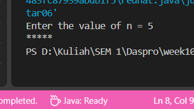
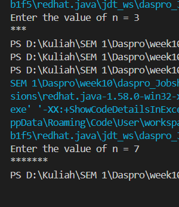
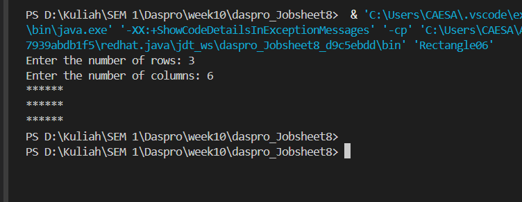
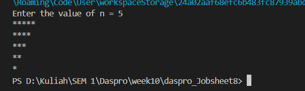
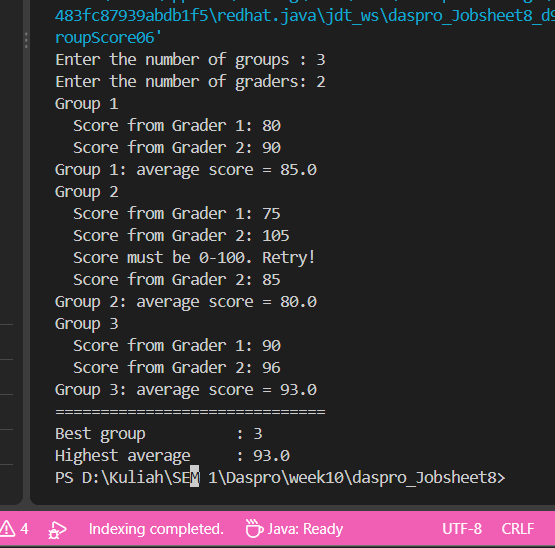

# JOBSHEET 8 - LOOPS 2

**Identitas Mahasiswa:**
* **Nama:** Datu Ayu Fitria Ceasa
* **NIM:** 264107020087
* **Kelas / No. Presensi:** 1I / 06

---

## 1: OBJECTIVES

1. Understand the concept of nested loops in algorithms 
2. Understand the flow of nested loops
3. Recognize the syntax of nested loops
4. Be able to apply nested loops to solve a simple case study. 

---

## 2: Practical Exercises

### 2.1 Experiment 1: Review of Loops 1

#### 2.1.1 Java Code
```java
import java.util.Scanner; 

public class Star06 { 
    public static void main(String[] args) { 
        Scanner sc = new Scanner(System.in); 
        System.out.print("Enter the value of n = "); 
        int n = sc.nextInt(); 
        
        for (int i = 1; i <= n; i++) { 
        System.out.print("*"); 
        } 
        System.out.println(); 
        sc.close(); 
    } 
}
```

#### 2.1.2 Screenshot Output




#### 2.1.3 Questions
* **Question 1:** If the initialization i = 1 is changed to i = 0 without changing the condition, how many characters are printed when n = 5? Explain.
  * **Answer:** If i starts at 0 and the condition stays i <= n, the loop prints a star for each value from 0 through 5 when n is 5. That is 6 values, so 6 stars are printed.
* **Question 2:** If the condition i <= n is changed to i < n, how many times does the loop run when n = 5? Why is the result different?  
  * **Answer:** With i starting at 0 and the condition i < n, the loop runs 5 times for n = 5, with i taking values 0 through 4. It differs because < stops before i reaches 5, while <= includes 5 and runs one extra time.
* **Question 3:** Predict the output of the following code fragment when n = 9, then verify it by replacing the FOR loop in your program and running it.
  ```
  for (int i = 2; i <= n; i += 2) { 
  System.out.print(i + " "); 
  } 
  ```
  * **Answer:** ----------
* **Question 4:** Explain why changing the increment i++ to i-- (with the condition still i <= n) makes the loop run endlessly, so that it does not stop in a reasonable time for positive n. Do not run that version; if it has already started running, stop the program by pressing Ctrl + C in the terminal. 
  * **Answer:** -----------

---

### 2.2  Experiment 2: Rectangle Star Pattern (Nested FOR)

#### 2.2.1 Java Code
```java
import java.util.Scanner; 

public class Rectangle06 { 
    public static void main(String[] args) { 
        Scanner sc = new Scanner(System.in); 
        System.out.print("Enter the number of rows: "); 
        int rows = sc.nextInt(); 
        System.out.print("Enter the number of columns: "); 
        int columns = sc.nextInt(); 

        for (int i = 1; i <= rows; i++) {    // outer loop: rows     
            for (int j = 1; j <= columns; j++) {   // inner loop: columns 
                System.out.print("*"); 
            } 
            System.out.println();    // new line              
        } 
    } 
}
```



#### 2.2.3 Questions
* **Question 1:** Explain the function of the variables i and j in the program.
  * **Answer:** ------------
* **Question 2:** How many times are the outer loop, the inner loop, and the statement print("*") executed for rows = 4 and columns = 7? 
  * **Answer:** --------------
* **Question 3:** What happens if the bounds of the outer and inner loops are swapped (the outer loop uses columns and the inner loop uses rows)? Use rows = 3 and columns = 6 to explain. 
  * **Answer:** ----------
* **Question 4:** Explain the effect of removing System.out.println(); after the inner loop.  
  * **Answer:** -------------
* **Question 5:** Modify the program so that the printed character is #, then commit and push the changes to GitHub.
  * **Answer:** -------------

### 2.3 Experiment 3: Debugging a Star Triangle – Nested WHILE

#### 2.3.1 Java Code
```java
import java.util.Scanner; 
 
public class Triangle06 { 
    public static void main(String[] args) { 
        Scanner sc = new Scanner(System.in); 
        System.out.print("Enter the value of n = "); 
        int n = sc.nextInt(); 
 
        int i = n; 
        while (i > 0) { 
            int j = 0; 
            while (j < i) { 
                System.out.print("*"); 
                j++; 
            } 
            System.out.println(); 
            i--; 
        } 
        sc.close(); 
    } 
}
```

#### 2.3.2 Screenshot Output



#### 2.3.3 Questions
* **Question 1:** Identify the mismatches in the initial output, and at least two fixes needed to produce a nested triangle pattern.
  * **Answer:** ------------
* **Question 2:** Explain the roles of the variables i and j. Why must the value of j be reset to 0 in every iteration of the outer loop? What happens if j is not reset? 
  * **Answer:** ------------
* **Question 3:** Explain the changes to the initialization, the condition, and the update of the outer loop that are needed to form the inverted triangle. 
  * **Answer:** -------------------

### 2.4 Experiment 4: Case Study of Group Project Scores

#### 2.4.1 Java Code
```java
import java.util.Scanner; 

public class GroupScore06 { 
    public static void main(String[] args) {
        Scanner sc = new Scanner(System.in);
        System.out.print("Enter the number of groups : "); 
        int numGroups = sc.nextInt(); 
        System.out.print("Enter the number of graders: "); 
        int numGraders = sc.nextInt(); 
 
        if (numGroups <= 0 || numGraders <= 0) { 
            System.out.println("Groups and graders must be > 0."); 
        } else { 
            int groupNo = 1;                   // outer loop counter 
            double highestAverage = -1;        // -1: the first group is recorded 
            int bestGroup = 0; 

            while (groupNo <= numGroups) { 
                System.out.println("Group " + groupNo); 
                double totalScore = 0; 
 
                for (int j = 1; j <= numGraders; j++) { 
                    int score; 
                    do { 
                        System.out.print("  Score from Grader " + j + ": "); 
                        score = sc.nextInt(); 
                        if (score < 0 || score > 100) { 
                            System.out.println("  Score must be 0-100. Retry!"); 
                        } 
                    } while (score < 0 || score > 100); 
                    totalScore += score; 
                }  
 
                double averageScore = totalScore / numGraders; 
                System.out.println("Group " + groupNo 
                        + ": average score = " + averageScore); 
                if (averageScore > highestAverage) {
                    highestAverage = averageScore;
                    bestGroup = groupNo;
                }
 
                groupNo++; 
            } 
            System.out.println("==============================");
            System.out.println("Best group          : " + bestGroup);
            System.out.println("Highest average     : " + highestAverage);
        } 
        sc.close(); 
    } 
} 
```

#### 2.4.2 Screenshot Output



#### 2.4.3 Questions
* **Question 1:** Why must totalScore be reset inside the outer loop, but highestAverage must not be reset for each group? 
  * **Answer:** ------------
* **Question 2:** For 3 groups and 2 graders (without any invalid input), how many times is the body of the FOR loop executed in total? 
  * **Answer:** ------------
* **Question 3:** What happens if totalScore is declared as int and the average is calculated using integer division? Give an example of values.
  * **Answer:** -------------------
* **Question 4:** Why is highestAverage given the initial value -1 rather than 0? Give an example of input that produces a wrong result if the initial value were 0.
  * **Answer:** -------------------
* **Question 5:** This program has three levels of loops. Name each type of loop and its role.
  * **Answer:** -------------------


---

## 3: Assignment 

The following is a list of tasks performed on this Jobsheet:

### Task 1:  Nested Number Pattern 
Write a program that prints a number pattern from 1 up to the row number. Enter an integer n (n is at least 1). The first row prints 1, the second row prints 1 2, and so on up to row n. After the pattern is complete, display the total number of digits that have been printed. Save the file with the name: Task1StudentNo.java. For n = 5:
    
      ```
      Enter the value of n = 5 
        1 
        1 2 
        1 2 3 
        1 2 3 4 
        1 2 3 4 5 
        Total numbers printed: 15
      ```

 
### Task 2: Multiplication Table
Write a program that displays a multiplication table of size n × n using nested FOR or WHILE 
loops. The value of n is at least 3. Each position displays the product of its row number and 
column number. Arrange the spacing so that the output is neat, then display the sum of all 
the numbers in the table. Save the program with the file name: Task2StudentNo.java. 
For n = 4: 
```
Enter the value of n = 4 
    1  2  3  4 
    2  4  6  8
    3  6  9 12 
    4  8 12 16 
Total of all numbers: 100
```

### Task 3: Sales Recap for Several Stores 
A shopping center has several stores. Each store serves a number of customers on the same day, and each customer buys several items. The program asks for the number of stores, then the number of customers at each store, and the number of items bought by each customer. Calculate and display the total number of customers and the total number of items for each store, the total number of items across all stores, and the number of the store with the most items. If several stores share the highest value, display the store with the smallest number. Save the program with the file name: Task3StudentNo.java. 
Requirements: the number of stores is at least 1. The number of customers and the number of items per customer may be 0, but must not be negative. Use nested loops. The data does not need to be stored one by one; it is sufficient to accumulate it into the total variables. Example: Store 1 has 2 customers who bought 3 and 2 items; Store 2 has 3 customers who bought 1, 4, and 2 items. The expected summary is: 
```
Store 1 - customers: 2, total items: 5 
Store 2 - customers: 3, total items: 7 
Total items across all stores: 12 
Store with the most items: 2 
```

### 3.1 Task 1 Code Implementation

```java
import java.util.Scanner;

public class ticketSale {
    public static void main(String[] args) {
        Scanner sc = new Scanner(System.in);
        int TICKET_PRICE = 50000;
        int customerCount, totalTickets = 0;
        double totalRevenue = 0;

        System.out.print("Enter the number of customers: ");
        customerCount = sc.nextInt();

        for (int i = 1; i <= customerCount; i++) {
            int quantity;
            do {
                System.out.print("Enter the number of tickets for customer " + i + ": ");
                quantity = sc.nextInt();
                if (quantity < 0) {
                    System.out.println("Invalid quantity. Please enter a non-negative number.");
                }
            } while (quantity < 0);

            double discountRate = 0;
            if (quantity > 10) {
                discountRate = 0.15;
            } else if (quantity > 4) {
                discountRate = 0.10;
            }

            totalTickets += quantity;
            totalRevenue += quantity * TICKET_PRICE * (1 - discountRate);
        }
        System.out.println("Total tickets sold: " + totalTickets);
        System.out.printf("Total ticket sales revenue: Rp %.0f%n", totalRevenue);
    }
}
```


### 3.2 Task 2 Code Implementation
```java
import java.util.Scanner;

public class motorcycle {
    public static void main(String[] args) {
        Scanner sc = new Scanner(System.in);
        int type, duration, total = 0;

        do {
            System.out.print("Enter vehicle type (1=Car, 2=Motorcycle, 0=Exit): ");
            type = sc.nextInt();

            if (type == 1 || type == 2) {
                System.out.print("Enter parking duration in hours: ");
                duration = sc.nextInt();

                if (type == 1) {
                    total += duration * 3000;
                } else {
                    total += duration * 2000;
                }
            } else if (type != 0) {
                System.out.println("Invalid vehicle type. Please enter 1, 2, or 0.");
            }
        } while (type != 0);

        System.out.println("Total parking fee: Rp " + total);
    }
}
```


### 3.3 Task 3 Code Implementation


---

## 4: Conclusion

These programs demonstrate how loops and conditional
